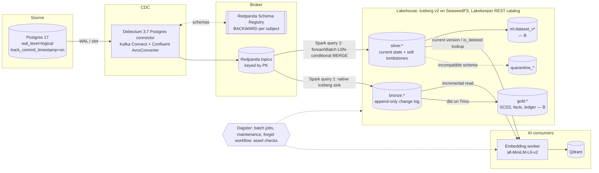

# AI Data Reliability Platform: design

CDC → Iceberg → vector index + versioned training datasets.
Source plan: [`delegated-orbiting-garden.md`](../delegated-orbiting-garden.md) (PLAN.md). Decisions: [`docs/adr/`](adr/).

> Every number in this document is a **target** (an SLO we commit to measure against) or a **pin**.
> No measured result appears here. Results come only from runs recorded in `runs/manifests/` (G11).

## 1. Architecture

Lineage (B): Debezium OpenLineage, OpenLineage Spark listener, openlineage-dbt and custom emitters → Marquez.
Observability (B): Prometheus + Grafana. Customer IDs are never used as metric labels.

### 1.1 Data flow (one change)
1. An app transaction commits in Postgres. WAL records it; `track_commit_timestamp` stores the commit time (**t0**).
2. Debezium reads the logical slot and produces an Avro envelope `{before, after, op, source{lsn, txId, ts_ms}}` keyed by PK to `cdc.public.<table>`. The schema is registered under `<topic>-value`. A delete also produces a tombstone (null value).
3. Redpanda appends with `LogAppendTime` (**t_broker**).
4. **Spark query 1 (bronze):** `writeStream.format("iceberg")`. It stores the raw record losslessly (topic, partition, offset, kafka_ts, key_bytes, value_bytes, schema_id) plus decoded envelope columns. It is epoch-idempotent because the sink records query id + epoch in the snapshot summary.
5. **Spark query 2 (silver):** foreachBatch. Drop tombstones → decode → dedupe to max LSN per key → `MERGE … WHEN MATCHED AND s.lsn > t.lsn THEN UPDATE … WHEN NOT MATCHED THEN INSERT`. Deletes become soft tombstones. The batch's commit is logged to the foreachBatch event log (**t_silver**).
6. **Embedding worker:** reads bronze incrementally from its last snapshot id. For each touched entity it looks up the current version and `is_deleted` in silver, then chunks, embeds and upserts with `wait=true` (**t_qdrant**). It then deletes older versions by filter.
7. Dagster runs maintenance, checks and the forget workflow. Milestone B adds dbt gold, dataset builds and lineage.

### 1.2 Deployment (Compose profiles)
| Profile | Services | RAM target |
|---|---|---|
| core | postgres, redpanda, connect, seaweedfs, lakekeeper, spark-streams (both queries, separate checkpoints), qdrant, app (embedding worker), dagster | ≤ 8 GB as configured today (plan: 10–12 GB) |
| transform | + trino | +3 GB |
| obs | + prometheus, grafana | +0.5 GB |
| lineage | + marquez (amd64-only image; emulated on Apple Silicon) | +1.5 GB |

Spark jobs, the embedding worker and Dagster share **one app image** to save disk. This is an implementation detail, not a design change: they remain separate processes and containers.

## 2. SLOs and how each is measured

All latencies are measured at a stated **achieved** change rate. Each measurement is a fixed-duration run with warmup discarded, ≥ 5 repetitions, reported as median with min/max (G11). The clocks for t0 and all sink timestamps are read inside the Docker VM; the host–VM offset is recorded at the start and end of each run, and a run is aborted if it exceeds 5 ms.

| ID | SLO (target) | Measurement method | Milestone |
|---|---|---|---|
| S1 | Freshness to broker p99 ≤ 5 s | `t_broker − t0` per change. t0 = `source.ts_ms` (commit time), joined to the ground-truth log by txid. t_broker = Kafka LogAppendTime. | A |
| S2 | Freshness to silver p99 ≤ 60 s | `t_silver − t0`. t_silver = commit time of the Iceberg snapshot holding the change, from the foreachBatch event log `(batch_id, snapshot_id, committed_at, [(pk, lsn)])`. | A |
| S3 | Freshness to Qdrant p99 ≤ 120 s | `t_qdrant − t0`. t_qdrant = `wait=true` ack time of the point batch containing the entity version. The black-box prober reports alongside: sentinel rows inserted at a fixed low rate, polled with a filtered scroll every ≤ 6 s (SLO/20). | A |
| S4 | Freshness to gold ≤ 15 min | `t_gold − t0`. t_gold = completion of the first dbt run whose max source LSN ≥ the change's LSN. | B |
| S5 | Training data staleness at build ≤ 24 h | `build_time − max(t0)` in the dataset's source snapshot. This is staleness at build time, not per-change freshness. | B |
| S6 | Logical deletion ≤ 15 min, all sinks | From `forget()` request time to the verifier first observing absence by query in each sink (Postgres row, silver `is_deleted`, bronze rows, quarantine, Qdrant filter, gold/dataset in B). Reported per sink. | A |
| S7 | Physical deletion ≤ 24 h, Iceberg + Qdrant | From the request to the verifier finding no bytes of the entity id. Iceberg: object-store listing + Parquet scan of every remaining file. Qdrant: segment vacuum observed (or bound reported). | A |
| S8 | Physical deletion bounds, broker and WAL | Redpanda: time until no segment contains the key (bounded by `segment.ms` + compaction/`retention.ms`). Postgres: dead tuple gone after `VACUUM`; WAL gone after the slot advances and segments recycle. **Reported as measured bounds, not targets we tune to.** | A |
| S9 | Idempotency: 0 duplicates, 0 losses, 0 resurrections | After each replay/crash fault, silver is compared with the ground-truth oracle at a consistent cut. Hypothesis property test over 1,000 cases (pure-Python merge model) + ~50 local-Spark cases. | A |
| S10 | Reconciliation: 0 mismatches after recovery | Consistent-cut reconciler: pause the generator; `cut = pg_current_wal_lsn()`; wait for `confirmed_flush_lsn ≥ cut`; record topic end offsets; wait for silver's committed offsets ≥ those offsets; compare counts and `Σ xxhash64(canonical row) mod 2^64` per table and per pk bucket. | A |
| S11 | DQ: every "expected: caught" fault in §5 is caught by its named check | Fault runs scored against §5 (pre-registered). Reported caught / self-healed / silent. Blind faults are reported separately. | A (6) / B (all) |
| S12 | DQ false alarms ≤ 1 per 20 clean runs | Count of blocking-check failures over ≥ 20 fault-free runs. | A |
| S13 | Replication slot health: retained WAL < 1 GiB and connector RUNNING | `pg_replication_slots` (`pg_current_wal_lsn() − confirmed_flush_lsn`) + Connect REST status, exported by `adrp.obs.exporter` on `:9108/metrics` (`adrp_replication_slot_lag_bytes`, `adrp_replication_slot_retained_wal_bytes`, `adrp_connector_up`). Note `confirmed_flush_lsn` advances when Connect flushes offsets (default every 60 s) and on heartbeats, so lag is a sawtooth, not a smooth line. An alert on breach is a named check (G13). | A |

## 3. Data inventory (every place a customer's data can live; drives G8)

| # | Location | What of the customer it holds | Logical removal | Physical removal | Verification | Milestone |
|---|---|---|---|---|---|---|
| 1 | Postgres `customers` + FK rows (accounts, transactions, refunds, support_tickets) | PII + ids | `DELETE` / pseudonymize per policy | dead tuples until `VACUUM`; measure | query + `pageinspect`/raw scan after VACUUM | A |
| 2 | Postgres WAL | before/after images (REPLICA IDENTITY FULL) | n/a | after the slot advances past the LSN and segments recycle; measure | `pg_walfile_name` vs files in `pg_wal` | A |
| 3 | Postgres backups | none taken (stated) | — | — | — | — |
| 4 | Redpanda `cdc.public.customers` | key + full images | tombstone | `compact,delete`, short `segment.ms` / `retention.ms`; active segment never compacted | `rpk topic consume` raw scan for key bytes | A |
| 5 | Redpanda topics of other tables | `customer_id` in values | n/a | `retention.ms` only (bound stated) | raw scan | A |
| 6 | Schema Registry | schemas only, no data | — | — | — | — |
| 7 | Kafka Connect offsets/config/status topics | LSNs, no PII | — | — | — | — |
| 8 | Iceberg `bronze.*` | raw `value_bytes` + before/after PII | `DELETE WHERE` | rewrite → drop refs → drain readers → expire → orphan removal | object-store listing + Parquet scan for the id | A |
| 9 | Iceberg `silver.*` | current PII | soft tombstone (non-key columns NULL) | same Iceberg procedure (older files still hold PII) | same | A |
| 10 | Iceberg `quarantine_*` | raw rows with PII | `DELETE WHERE` | same Iceberg procedure | same | A |
| 11 | Iceberg orphan files from killed writes | possibly PII | n/a | `remove_orphan_files` (older_than ≥ max write duration) | listing | A |
| 12 | Iceberg `gold.*` | dims (PII), ledger/transactions (customer_id) | dims delete/pseudonymize; ledger **pseudonymize** (never delete entries) | same Iceberg procedure | same | B |
| 13 | Iceberg `ml.dataset_v*` + Parquet exports | training rows | invalidate → rebuild v{n}.1 → drop v{n} | Iceberg procedure + delete exports | same | B |
| 14 | Qdrant collection | chunk text + vectors | delete-by-filter `entity_id` | marked until the vacuum optimizer runs; trigger it or report the bound | filtered scroll + segment stats | A |
| 15 | Qdrant WAL / snapshots | points | n/a | `wal_capacity_mb` rollover; no snapshots taken (stated) | file scan of the storage volume | A |
| 16 | Generator ground-truth log + run log (Parquet) | PII payloads, txids | rewrite / pseudonymize | file rewrite | Parquet scan | A |
| 17 | foreachBatch event log | pks + LSNs | pseudonymize pk | file rewrite | Parquet scan | A |
| 18 | Spark checkpoints / state | offsets only (no stateful ops) | — | — | inspect | A |
| 19 | Spark local spill dirs | ephemeral shuffle data | n/a | container restart (bound stated) | — | A |
| 20 | Embedding worker state (`embedder.json`) | bronze snapshot pointer + ids of changes waiting for silver (`pending`) | pseudonymize / rewrite | file rewrite | file scan | A |
| 21 | Dagster run logs / event storage | must never contain raw ids (enforced by code review + grep check) | — | — | grep | A |
| 22 | Prometheus TSDB | no customer labels by rule | — | — | label audit | B |
| 23 | Marquez | dataset/job metadata only | — | — | — | B |
| 24 | Forget audit table | `hmac(customer_id)` only | — | — | — | A |
| 25 | Embedder action log (`actions.jsonl`) | entity ids (`help_articles:<id>`, `support_tickets:<id>`) and LSNs per upsert / delete | pseudonymize ids | file rewrite | file scan | A |

## 4. Timestamp capture points (drives G11)

| Point | Source | Recorded in |
|---|---|---|
| t0 | Postgres commit time (`track_commit_timestamp`) = Debezium `source.ts_ms` | bronze `source_ts`; joined to ground truth via `source.txId` ↔ run-log txid |
| t_broker | Kafka record timestamp, topics set to `message.timestamp.type=LogAppendTime` | bronze `kafka_ts` |
| t_bronze | commit time of the bronze snapshot (snapshot summary) | Iceberg metadata |
| t_silver | foreachBatch commit time | foreachBatch event log (Parquet) |
| t_gold | dbt model completion with max source LSN ≥ change LSN | dbt run log (B) |
| t_qdrant | `wait=true` ack of the upsert batch | embedding worker event log (Parquet) |
| prober | sentinel insert time / first-seen time per sink | prober log (Parquet) |

## 5. Pre-registered fault matrix

Committed **before any check exists** (this commit). G5/G10 score results against this table without editing the "expected" columns. Changes after this point get a new row or a dated note; the original row is never rewritten.

| ID | Fault | Injection | Expected detection (named check) | Expected outcome | Milestone |
|---|---|---|---|---|---|
| F1 | Duplicate events | Reset the silver/bronze consumer to replay an offset range | none needed | self-healed: silver unchanged (LSN guard); bronze holds duplicate rows by design | A |
| F2 | Out-of-order updates | Produce older-LSN versions of a key after newer ones | none needed | self-healed: older LSN ignored by the MERGE condition | A |
| F3 | Spark kill mid-MERGE | `SIGKILL` the streaming container during foreachBatch | reconciler (if any mismatch) | self-healed on restart: batch re-run is idempotent; orphan files left for G8 cleanup | A |
| F4 | Connector crash mid-snapshot | Kill the Connect worker during the initial snapshot | connector-status alert | self-healed or caught: snapshot restarts; duplicates absorbed by the LSN guard | A |
| F5 | Redpanda restart | Restart the broker under load | connector-status / slot-lag alert during downtime | self-healed: no loss after recovery | A |
| F6a | Schema drift: add column | `ALTER TABLE … ADD COLUMN` on a live table | none needed | self-healed: column appears in silver without a restart | A |
| F6b | Schema drift: incompatible change | Type narrowing or rename | registry compatibility check (CI) / quarantine count > 0 | caught: rows land in `quarantine_<table>` with `SCHEMA_INCOMPATIBLE` | A |
| F7 | Late-arriving rows | Delay a partition's records past the gold lookback | gold freshness / reconciliation check | caught | B |
| F8 | Null keys | Produce records with null PK | null-key check → quarantine | caught | B |
| F9 | Qdrant unavailable | Stop Qdrant during a burst | stale-chunk check / embed-lag check | self-healed after restart; stale = 0 within S3 after recovery | B |
| F10 | Embedding model version change | Change `embed_model_version` mid-run | model-version-mismatch check | caught | B |
| F11 | **Blind:** random field corruption | Flip random bytes in random non-key fields of random silver rows (seeded) | none designed; prediction: reconciler checksum | unknown; reported honestly | B |
| F12 | **Blind:** dropped partition range | Delete one bronze/silver partition's data files (seeded) | none designed; prediction: reconciler count/checksum | unknown; reported honestly | B |
| F13 | TOAST placeholder leak | Update a non-text column of a 10 KB help article | `__debezium_unavailable_value` count = 0 | must not occur (REPLICA IDENTITY FULL); caught if it does | A |

## 6. Version matrix (pinned; source of truth `versions.env`)

Policy: stable, non-prerelease, released ≥ 14 days before pinning (on or before 2026-10-11). `scripts/check_versions.py` fails CI if this table and `versions.env` disagree.

<!-- versions:begin -->
| Component | Pin |
|---|---|
| Postgres | postgres:17.10-alpine |
| Debezium | 3.7.0.Final |
| Confluent Avro converter | 8.3.2 |
| Redpanda | redpandadata/redpanda:v26.2.4 |
| Spark | 4.1.3 |
| Iceberg | 1.12.0 |
| Iceberg format-version | 2 |
| Lakekeeper | quay.io/lakekeeper/catalog:v0.13.6 |
| Object store (SeaweedFS) | chrislusf/seaweedfs:4.48 |
| Qdrant | qdrant/qdrant:v1.19.2 |
| Trino | trinodb/trino:483 |
| dbt-core | 1.12.5 |
| dbt-trino | 1.10.6 |
| Dagster | 1.13.26 |
| OpenLineage | 1.53.0 |
| Marquez | marquezproject/marquez:0.50.0 |
| pyiceberg | 0.12.0 |
| Embedding model | sentence-transformers/all-MiniLM-L6-v2 |
<!-- versions:end -->

Why Spark 4.1.3 and not 4.2.0: Iceberg 1.12.0 publishes no `iceberg-spark-runtime-4.2` artifact.

## 7. Non-goals
- Production scale or multi-node HA. Single node; numbers are stated with hardware.
- Exactly-once claims. We claim "idempotent under the tested faults."
- Compliance certification. We claim "deletion propagation verified in this system."
- LLM serving, RAG answer quality, or prompt evaluation.
- Row-level lineage via OpenLineage. Row provenance comes from columns (G7).
- Backups and disaster recovery of Postgres (inventory row 3 states none are taken).

## 8. Threats to validity
- **Single machine:** every component shares CPU and memory, so latencies include contention. Docker Desktop's VM is capped at 8 GB / 4 CPU today. The profile and limits go into every run manifest.
- **Emulation:** the Marquez image is amd64-only and runs under emulation, so it is off for measurement runs.
- **Clock skew:** mitigated by timestamping inside one VM plus the host–VM offset check. Commit timestamps are Postgres's own clock.
- **Generator fidelity:** synthetic skew does not match a real workload. The achieved rate is reported, not the target.
- **Checks tuned to faults:** mitigated by this pre-registered matrix and two blind faults. Undetected faults may still exist; zero detections ≠ zero faults.
- **Small collections:** Qdrant may never reach `deleted_threshold`, so the physical-deletion bound may be "until forced optimization."
- **Compaction conflicts:** `rewrite_data_files` can fail validation against concurrent MERGE delete files; the conflict rate is recorded rather than hidden.
- **Repetitions:** ≥ 5 per point; small-sample medians, not distributions.
